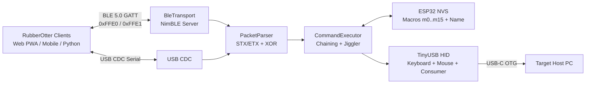

# RubberOrca

[](https://github.com/AtaCanYmc/RubberOrca/actions/workflows/ci.yml)
[](LICENSE)

Single-chip ESP32-S3 firmware that exposes a wired USB HID keyboard, mouse, and consumer control interface to a target host while accepting wireless commands over BLE 5.0 GATT.

## Table of Contents

- [Architecture](#architecture)
- [Quick Start](#quick-start)
- [Supported Hardware](#supported-hardware)
- [Protocol and Commands](#protocol-and-commands)
- [Repository Structure](#repository-structure)
- [Technical FAQ](#technical-faq)
- [Contributing and Security](#contributing-and-security)
- [License](#license)

## Architecture

RubberOrca replaces the dual-chip `ATmega32U4` and `HM-10` UART bridge from [RubberOtter](https://github.com/AtaCanYmc/RubberOtter) with a single ESP32-S3 SoC. The target host enumerates a standard wired USB composite device without host-side Bluetooth pairing. Existing RubberOtter clients (Web PWA, Capacitor mobile apps, Python SDK, CLI, and MCP server) connect over BLE GATT `0xFFE0` / `0xFFE1` without modification.



## Quick Start

Requires [PlatformIO Core](https://platformio.org/install/cli) (`pio`).

```bash
# 1. Run host-side protocol and command unit tests
pio test -e native

# 2. Build firmware for ESP32-S3 Super Mini or N16R8
pio run -e esp32s3_supermini
pio run -e esp32s3_n16r8

# 3. Flash the connected board
pio run -e esp32s3_supermini -t upload
```

Plug the board's native USB-C OTG port into the target computer. Connect from any RubberOtter client over BLE Service `0000ffe0-0000-1000-8000-00805f9b34fb` and Characteristic `0000ffe1-0000-1000-8000-00805f9b34fb`.

## Supported Hardware

| PlatformIO Env | Board Definition | Hardware Target | Flash / PSRAM | Partition Table |
| :--- | :--- | :--- | :--- | :--- |
| `esp32s3_supermini` | `lolin_s3_mini` | ESP32-S3 Super Mini | 4 MB / 2 MB QSPI | `huge_app.csv` |
| `esp32s3_n16r8` | `esp32-s3-devkitc1-n16r8` | ESP32-S3 N16R8 DevKitC | 16 MB / 8 MB OPI | `default_16MB.csv` |
| `native` | Host toolchain | Local unit test runner | N/A | N/A |

Both ESP32-S3 environments build with `-DARDUINO_USB_MODE=0` and `-DARDUINO_USB_CDC_ON_BOOT=1` so TinyUSB HID and USB CDC Serial share the native USB OTG peripheral. On the ESP32-S3 N16R8 DevKitC, connect the **`USB` (OTG)** port to the target host rather than the `UART` bridge port.

## Protocol and Commands

Framed packets use the RubberOtter v1 wire format:

```text
[STX: 0x02] [VER: 0x01] [SEQ: 1B] [LEN_HI: 1B] [LEN_LO: 1B] [PAYLOAD: N B] [XOR: 1B] [ETX: 0x03]
```

The device replies with a 6-byte ACK frame `[0x02, 0x01, SEQ, OK, CODE, 0x03]` over BLE notify and USB CDC. Error codes are `1` for invalid version or command, `2` for payload exceeding 1024 bytes, and `3` for XOR checksum mismatch. Single-byte fallback commands (`0x11` to `0x85`) execute directly when the parser is idle.

| Command | Arguments | Behavior |
| :--- | :--- | :--- |
| `type` | `"text"` | Types ASCII text over USB HID. Supports `\n`, `\t`, `\"`, and `\\` escapes. |
| `delay` | `<ms>` | Pauses execution for `<ms>` milliseconds. |
| `enter`, `tab`, `backspace` | None | Sends the corresponding single HID keystroke. |
| `press` | `<mod> [ms]` | Presses `shift`, `ctrl`, `alt`, `gui`, `win`, `right`, `left`, `f5`, `gui l`, `gui d`, or `ctrl shift esc`. |
| `hold` / `release` | `<mod>` | Holds or releases `shift`, `ctrl`, `alt`, `gui`, or `win`. |
| `media` | `<action>` | Sends Consumer Control usage: `play_pause`, `volume_up`, `volume_down`, `next`, `prev`, or `mute`. |
| `mouse move` | `<dx> <dy>` | Moves the relative USB HID pointer by signed 8-bit deltas. |
| `mouse click` | `left\|right\|middle` | Clicks the specified mouse button. |
| `mouse scroll` | `<amount>` | Scrolls the vertical wheel by a signed 8-bit delta. |
| `jiggler` | `on\|off\|toggle` | Toggles a 20 px square return-to-origin mouse pulse every 5000 ms. |
| `macro define` | `m0..m15 { body }` | Persists a command chain in ESP32 NVS under namespace `orca`. |
| `macro run` | `m0..m15` | Executes a stored NVS macro with recursion depth capped at 4. |
| `ble name` | `"name"` | Updates BLE advertising name and persists it in NVS across reboots. |
| `vibrate` | `<ms>` | Pulses `VIB_PIN` if defined at compile time. No-op otherwise. |
| `help`, `?` | None | Prints the command list to BLE and USB CDC. |

Commands can be chained with `&&` or `;`. Separators inside quoted strings and `{ ... }` macro definitions are preserved.

## Repository Structure

```text
RubberOrca/
├── include/
│   ├── Backend.h               # Hardware-agnostic HID, transport, and NVS callbacks
│   └── Protocol.h              # Framing constants, buffer sizes, and BLE UUIDs
├── src/
│   ├── BleTransport.h/.cpp     # Thread-safe NimBLE GATT server (0xFFE0 / 0xFFE1)
│   ├── CommandExecutor.h/.cpp  # Command parser, chaining, jiggler, and macro dispatch
│   ├── Esp32Backend.cpp        # TinyUSB HID, USB CDC, and ESP32 Preferences backend
│   ├── PacketParser.h/.cpp     # Ring-buffered STX/ETX XOR frame and 1-byte parser
│   ├── Utils.h/.cpp            # String utilities and ACK frame serializer
│   └── main.cpp                # Arduino setup() and loop() entry point
├── test/
│   └── test_protocol/
│       └── test_protocol.cpp   # Unity host unit tests for framing and commands
├── platformio.ini              # Super Mini, N16R8, and native test environments
├── CONTRIBUTING.md
├── ROADMAP.md
├── SECURITY.md
└── LICENSE
```

## Technical FAQ

**Why use BLE GATT `0xFFE0` / `0xFFE1` instead of native BLE HID?**
Native BLE HID requires Bluetooth pairing on the target computer. Using BLE GATT for wireless control while keeping the host link strictly wired USB HID eliminates host-side Bluetooth pairing and maintains drop-in compatibility with existing RubberOtter clients.

**Why store macros in NVS (`Preferences`) instead of LittleFS in v1?**
ESP32 NVS is wear-leveled, power-loss safe, and requires no filesystem image upload. Sixteen 1024-byte slots cover typical macro workloads with minimal flash overhead. LittleFS storage is planned for larger script files and an on-device Web UI in [ROADMAP.md](ROADMAP.md).

## Contributing and Security

- Read [CONTRIBUTING.md](CONTRIBUTING.md) for branch conventions, Conventional Commits, and local verification steps.
- Report security vulnerabilities privately using [SECURITY.md](SECURITY.md).
- Track upcoming milestones in [ROADMAP.md](ROADMAP.md).

## License

Licensed under the Apache License 2.0. See [LICENSE](LICENSE) for full terms.
