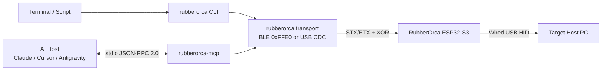

[Back to Documentation](README.md) | [Back to Root README](../README.md)

# CLI and MCP Reference

The `cli/` package ships two console entry points sharing `rubberorca.protocol` and `rubberorca.transport`: `rubberorca` for terminal automation and `rubberorca-mcp` for AI agent tool execution over stdio JSON-RPC 2.0.



## Installation

```bash
pip install -e ./cli
```

Requires Python 3.9 or newer. Runtime dependencies are `bleak` and `pyserial`.

## CLI (`rubberorca`)

### Global Flags

| Flag | Default | Description |
| :--- | :--- | :--- |
| `--port <PORT>` | None | Use USB CDC Serial instead of BLE GATT. |
| `--address <ADDR>` | None | Pin a specific BLE MAC address or macOS CoreBluetooth UUID. |
| `--baud <RATE>` | `115200` | Serial baud rate when `--port` is set. |
| `--timeout <SEC>` | `3.0` | Discovery, connect, and ACK timeout in seconds. |
| `--seq <0..255>` | `1` | Packet sequence number echoed in the 6-byte ACK. |

### Subcommands

| Subcommand | Arguments | Wire Output |
| :--- | :--- | :--- |
| `scan` | None | Lists BLE `0xFFE0` peripherals and local serial ports. |
| `send` | `<payload>` | Sends raw command or `&&` / `;` chain verbatim. |
| `type` | `<text>` | Escapes `"`, `\`, `\n`, `\t` and sends `type "..."`. |
| `key` | `enter\|tab\|backspace` | Sends single keystroke command. |
| `press` | `<mod> [ms]` | Sends `press <mod>` or `press <mod> <ms>` (`1`..`5000` ms). |
| `media` | `play_pause\|volume_up\|volume_down\|next\|prev\|mute` | Sends Consumer Control media command. |
| `mouse move` | `<dx> <dy>` | Sends `mouse move <dx> <dy>` (clamped to `[-127, 127]`). |
| `mouse click` | `[left\|right\|middle]` | Sends `mouse click <button>` (defaults to `left`). |
| `mouse scroll` | `<amount>` | Sends `mouse scroll <amount>` (clamped to `[-127, 127]`). |
| `jiggler` | `on\|off\|toggle` | Controls the 5-second return-to-origin mouse jiggler. |
| `macro define` | `<m0..m15> <body>` | Saves command chain into ESP32 NVS slot. |
| `macro run` | `<m0..m15>` | Executes stored NVS macro slot. |
| `ble-name` | `<name>` | Persists printable ASCII BLE name (`1`..`29` chars) in NVS. |
| `ble-passkey` | `<6-digit\|off>` | Persists 6-digit BLE bonding passkey (`100000`..`999999`) or disables bonding (`off`). |
| `layout` | `us\|tr_q` | Switches active USB HID keyboard layout and persists in NVS. |
| `raw-byte` | `<hex_or_dec>` | Sends single-byte fallback (`0x10`..`0x8F`) without ACK. |

### Exit Codes

| Code | Meaning |
| :--- | :--- |
| `0` | Command succeeded (`ACK ok=1`) or `scan` / `raw-byte` completed. |
| `1` | Transport, timeout, framing, or argument error. |
| `2` | Device returned NACK (`ACK ok=0`, error code printed). |

## MCP Server (`rubberorca-mcp`)

`rubberorca-mcp` implements Model Context Protocol `2024-11-05` over stdin/stdout using Python's standard library (`json`, `asyncio`).

### Supported JSON-RPC Methods

- `initialize`
- `notifications/initialized`
- `ping`
- `tools/list`
- `tools/call`

### Exposed MCP Tools

| Tool | Required Arguments | Optional Arguments |
| :--- | :--- | :--- |
| `scan_devices` | None | `timeout` (`0.5`..`15.0`) |
| `type_text` | `text` | `port`, `address` |
| `press_key` | `key` | `ms` (`1`..`5000`), `port`, `address` |
| `media_control` | `action` | `port`, `address` |
| `mouse_action` | `action` (`move`, `click`, `scroll`) | `dx`, `dy`, `button`, `amount`, `port`, `address` |
| `jiggler` | `state` (`on`, `off`, `toggle`) | `port`, `address` |
| `macro_define` | `slot` (`m0`..`m15`), `body` | `port`, `address` |
| `macro_run` | `slot` (`m0`..`m15`) | `port`, `address` |
| `send_command` | `command` | `port`, `address` |

### Environment Variables

| Variable | Default | Purpose |
| :--- | :--- | :--- |
| `RUBBERORCA_PORT` | Unset | Default USB CDC serial port when tool calls omit `port`. |
| `RUBBERORCA_ADDRESS` | Unset | Default BLE address/UUID when tool calls omit `address`. |
| `RUBBERORCA_TIMEOUT` | `3.0` | Default transport timeout in seconds. |

### MCP Client Configuration

BLE auto-discovery (default):

```json
{
  "mcpServers": {
    "rubberorca": {
      "command": "rubberorca-mcp",
      "args": []
    }
  }
}
```

Pinned USB CDC Serial device:

```json
{
  "mcpServers": {
    "rubberorca": {
      "command": "rubberorca-mcp",
      "args": ["--port", "/dev/cu.usbmodem1101"]
    }
  }
}
```

## Verification

```bash
make test-cli
```
